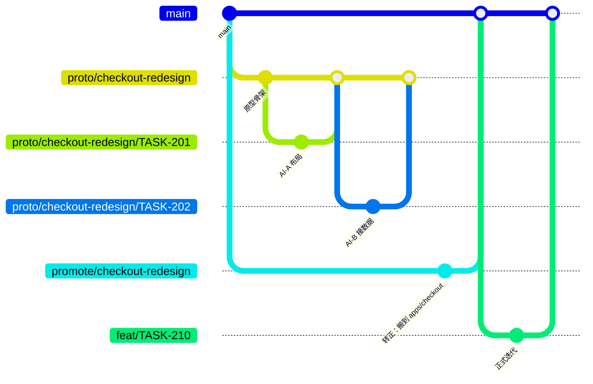

# multi-ai-repo

一个支持 **多个 AI 代理并行开发** 的 GitHub 仓库模板。

设计中的原型和已转正的正式代码，从目录、分支到 CI 全部隔开；每个 AI 只能在自己的任务边界内动手，越界会被 CI 直接拦下。

## 三条设计原则

| 原则 | 落地方式 | 解决什么 |
|---|---|---|
| **双轨隔离** | 原型在 `prototypes/`，正式代码在 `apps/` `packages/`；各自独立分支与 CI | 原型污染正式代码、正式重构踩坏原型 |
| **契约先行** | `ai/tasks/<ID>.yml` 声明 agent / 分支 / `allowed_paths` / 验收标准，`pr-guard` 逐条校验 | 多个 AI 抢同一个文件、顺手重构、PR 过大 |
| **单一合流** | 一律 squash 进主干；原型只能通过一次性的 `promote/<slug>` PR「转正」 | 历史混乱、无法回滚、原型代码悄悄渗入 main |

## 两条轨道

| | 原型轨（设计中） | 正式轨（已转正） |
|---|---|---|
| 目录 | `prototypes/<slug>/` | `apps/` `packages/` `services/` |
| 集成分支 | `proto/<slug>` | `main` |
| 任务分支 | `proto/<slug>/<TASK-ID>` | `feat/<TASK-ID>-<slug>` 等 |
| CI | 轻量：lint + 构建 + 冒烟 | 全量：lint + 单测 + 集成 + e2e + 安全扫描 |
| 合并 | CI 绿即自动 squash 合并 | 必须 1 人审批 + merge queue |
| 生命周期 | 30 天 TTL，可归档 | 版本化，长期维护 |
| 出口 | `promote/<slug>` PR → `apps/<target>/` | 无 |

> 判断标准很简单：**还在被推翻的，放 `prototypes/`；已经要对用户负责的，放 `apps/`。**
> 一个原型「转正」之后就不再回原型轨，后续改动走正式轨任务。



## 5 分钟上手

### 1. 建仓库

```bash
git init
git add -A
git commit -m "chore: bootstrap multi-ai repo"
git branch -M main
git remote add origin git@github.com:YOUR_ORG/YOUR_REPO.git
git push -u origin main
```

### 2. 打开 GitHub 上的开关（必须，否则守卫形同虚设）

1. **Settings → General → Pull Requests**
   - 勾选 `Allow auto-merge`
   - 勾选 `Allow squash merging`，关闭 merge commit 与 rebase merging
2. **Settings → Rules → Rulesets**，对 `main` 和 `proto/*` 各建一条：
   - `Require a pull request before merging`（`main` 设 1 个 approval，`proto/*` 设 0）
   - `Require status checks to pass`：勾选 `ci`、`pr-guard`
   - `Require linear history`、`Block force pushes`、`Restrict deletions`
   - 不允许 bypass

   > 状态检查必须先跑过一次才会出现在下拉框里。所以顺序是：先推一个分支开 PR →
   > 等 `ci` / `pr-guard` 跑完 → 再回来配置 ruleset。

3. **对 `main` 开启 merge queue**（私有仓库需要 GitHub Team 及以上）。
   模板的 `ci.yml` 已经监听 `merge_group` 事件，否则队列里的检查永远等不到结果。
4. **Actions → General → Workflow permissions** 选 `Read and write`（auto-merge 需要）

### 3. 把占位符换成真的

- `Makefile` 里的 `lint` / `test` / `proto-check` 三个 target —— **第一件要做的事**
- `.github/CODEOWNERS` 里的团队名
- `ai/policy.yml` 里的行数上限、TTL

### 4. 开第一个任务

```bash
python3 scripts/new_task.py \
  --id TASK-101 --track formal --agent claude-code-01 \
  --title "结算页接入优惠券接口" \
  --path 'apps/checkout/**' --path 'packages/payments/**'

git switch -c chore/TASK-101-plan
git add ai/tasks/TASK-101.yml
git commit -m "chore(task): 新增 TASK-101"
git push -u origin chore/TASK-101-plan
gh pr create --base main --title "chore(task): TASK-101" --body "Planner: alice"
```

任务文件合并后，AI 就可以开工了：

```bash
scripts/ai-bootstrap.sh TASK-101
# 然后让 AI 读 AGENTS.md + ai/tasks/TASK-101.yml
```

### 5. 开一个原型

见 [`prototypes/README.md`](prototypes/README.md)。

## 目录结构

```
.
├── AGENTS.md                  # 所有 AI 的行为准则（最重要）
├── CLAUDE.md                  # Claude Code 入口，转引 AGENTS.md
├── ai/
│   ├── policy.yml             # 机器可读的轨道规则
│   └── tasks/                 # 任务契约（一个任务一个文件）
├── apps/                      # 正式开发的应用
├── packages/                  # 正式开发的共享包
├── prototypes/
│   ├── _template/             # 新原型模板
│   └── <slug>/                # 单个原型（prototype.yaml 是它的身份证）
├── scripts/
│   ├── ai-bootstrap.sh        # AI 开工：同步 + 建分支 + 设置提交模板
│   ├── new_task.py            # 生成任务契约
│   ├── check_pr_contract.py   # PR 守卫的核心逻辑
│   ├── promote.py             # 原型转正（默认 dry-run）
│   └── report_expired.py      # 每周盘点过期原型
├── docs/
│   ├── ai-collaboration.md    # 完整协作模型与冲突手册
│   └── adr/                   # 架构决策记录
└── .github/
    ├── workflows/             # ci / pr-guard / auto-merge / housekeeping
    ├── CODEOWNERS
    └── pull_request_template.md
```

## 角色分工

| 角色 | 谁来做 | 产出 |
|---|---|---|
| Planner | 人或规划型 AI | `ai/tasks/*.yml`、原型 manifest、ADR |
| Worker | 执行型 AI | 任务分支上的代码 + PR |
| Reviewer | 人 | 正式轨的 approve；原型轨只在异常时介入 |

关键：**Worker 不能改自己的任务边界**。`ai/**` 是受保护路径，只有 Planner 的规划 PR 能改。

## 更多文档

- [`AGENTS.md`](AGENTS.md) —— AI 每次开工必读
- [`docs/ai-collaboration.md`](docs/ai-collaboration.md) —— 并发模型、冲突处理、共享文件对策
- [`docs/adr/0001-two-track-branching.md`](docs/adr/0001-two-track-branching.md) —— 为什么这样设计

## 这个模板不负责什么

- 具体的 lint / test 命令（换成你的技术栈）
- 部署流水线（在 `ci.yml` 的 `full` job 后面接）
- AI 的调度（谁来派任务）—— 模板只定义「派下来之后怎么安全地合并」
